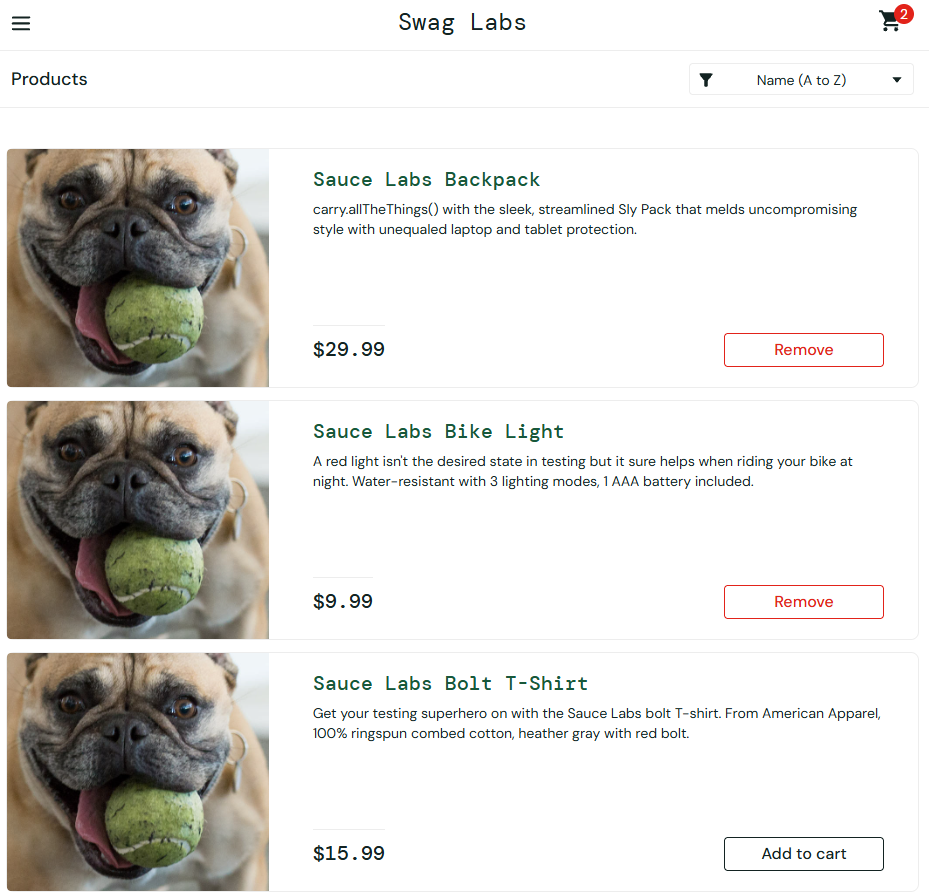
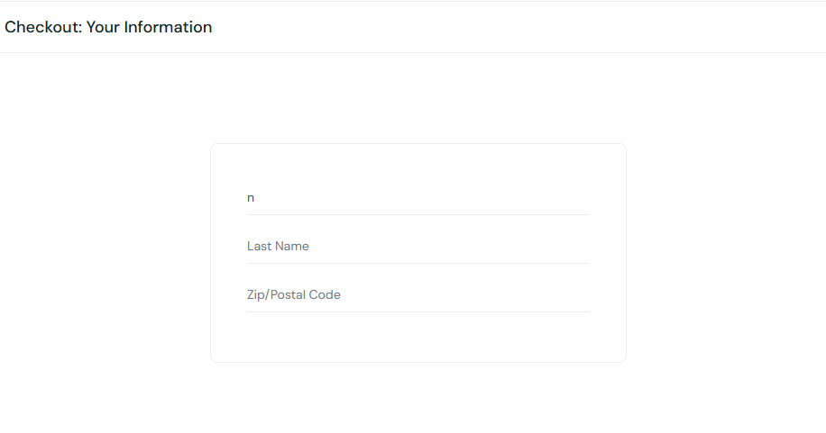
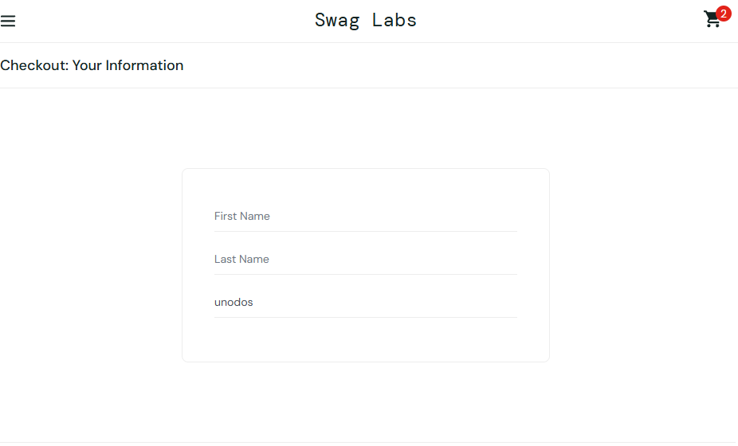
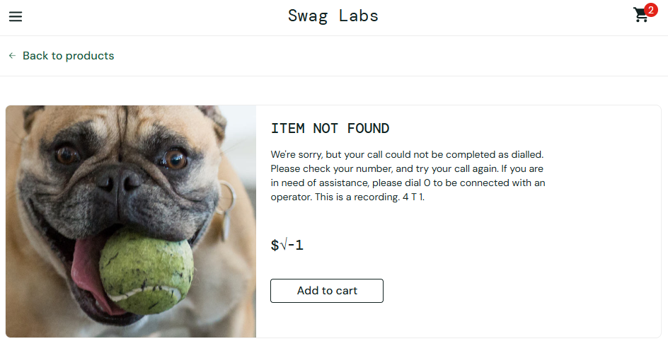
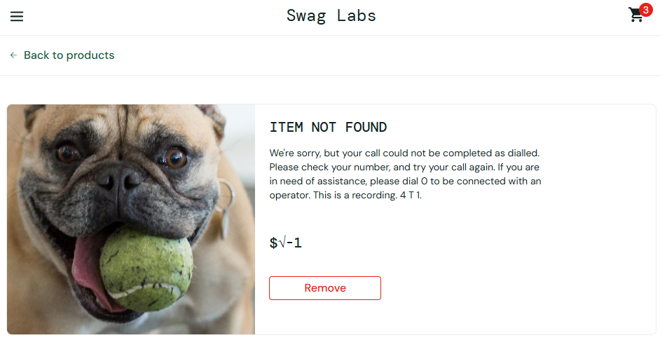

# Reporte de Incidencias (Bugs) - SauceDemo

Este documento recopila los informes de errores detectados durante las pruebas manuales de la aplicación.

---

## [BUG-001] Imágines de los productos incorrectas y repetidas en el catálogo

- **ID del Bug:** BUG-001
- **Título:** Las imágenes de los productos en el catálogo muestran el mismo avatar de un perro en lugar del artículo correspondiente.
- **Estado:** Abierto
- **Módulo afectado:** Catálogo de Productos (`/inventory.html`)
- **Autor/QA:** Cande Zamora

### ⚙️ Entorno / Dispositivo

- **Navegador:** Google Chrome (Última versión)
- **Sistema Operativo:** Windows
- **URL:** `https://www.saucedemo.com/inventory.html`

### 📊 Clasificación

- **Severidad:** Media _(Afecta a la experiencia visual del usuario pero permite seguir navegando)_
- **Prioridad:** P1 _(Es un error visible en la pantalla principal de la tienda)_

### 👣 Pasos para Reproducir (Steps to Reproduce)

1. Navegar a `https://www.saucedemo.com/`
2. En la pantalla de Login, introducir el usuario `problem_user`
3. Introducir la contraseña pública de prueba `secret_sauce`
4. Hacer clic en el botón **Login**
5. Observar las imágenes del catálogo de productos.

### 🎯 Comportamiento Esperado (Expected Result)

Cada producto en el catálogo debe mostrar la fotografía correspondiente a su artículo (por ejemplo, la mochila debe mostrar la mochila `sauce-backpack.jpg`).

### ❌ Comportamiento Real (Actual Result)

Todos los productos del catálogo cargan la misma imagen genérica de un perro (`sl-404.jpg`), sin mostrar la imagen real de los productos disponibles.

### 🖼️ Evidencias

---

## [BUG-002] El campo 'Last Name' redirige el texto y sobreescribe el campo 'First Name'

- **ID del Bug:** BUG-002
- **Título:** El campo 'Last Name' redirige el texto y sobreescribe el contenido del campo 'First Name'.
- **Estado:** Abierto
- **Módulo afectado:** Checkout: Your Information (`/checkout-step-one.html`)
- **Autor/QA:** Cande Zamora

### ⚙️ Entorno / Dispositivo

- **Navegador:** Google Chrome (Última versión)
- **Sistema Operativo:** Windows
- **URL:** `https://www.saucedemo.com/checkout-step-one.html`

### 📊 Clasificación

- **Severidad:** Alta _(Impide ingresar datos de envío válidos en el proceso de compra)_
- **Prioridad:** P1 _(Bloquea el flujo principal de conversión y checkout)_

---

### 👣 Pasos para Reproducir (Steps to Reproduce)

1. Navegar a `https://www.saucedemo.com/`
2. En la pantalla de Login, introducir el usuario `problem_user`
3. Introducir la contraseña pública de prueba `secret_sauce`
4. Hacer clic en el botón **Login**
5. Añadir un producto al carrito y hacer clic en el icono del carrito.
6. Hacer clic en el botón **Checkout**.
7. Escribir un nombre en el campo **First Name** (ej. "Cande").
8. Seleccionar el campo **Last Name** e intentar escribir un apellido.

### 🎯 Comportamiento Esperado (Expected Result)

El campo 'Last Name' debe aceptar el texto introducido manteniendo intacto el valor del campo 'First Name'

### ❌ Comportamiento Real (Actual Result)

Al teclear en 'Last Name', el foco/cursor se desplaza automáticamente a 'First Name', borrando su contenido y reemplazándolo por el texto tecleado.

### 🖼️ Evidencias

---

## [BUG-003] Ausencia de validación numérica en el campo 'Zip/Postal Code'

- **ID del Bug:** BUG-003
- **Título:** El campo 'Zip/Postal Code' permite ingresar letras y caracteres alfabéticos sin aplicar validación de formato postal.
- **Estado:** Abierto
- **Módulo afectado:** Checkout: Your Information (`/checkout-step-one.html`)
- **Autor/QA:** Cande Zamora

### ⚙️ Entorno / Dispositivo

- **Navegador:** Google Chrome (Última versión)
- **Sistema Operativo:** Windows
- **URL:** `https://www.saucedemo.com/checkout-step-one.html`

### 📊 Clasificación

- **Severidad:** Media _(Permite avanzar en la compra con datos de envío no válidos)_
- **Prioridad:** P2 _(Riesgo de generar direcciones incompletas o errores en la logística de envío)_

---

### 👣 Pasos para Reproducir (Steps to Reproduce)

1. Navegar a `https://www.saucedemo.com/`
2. En la pantalla de Login, introducir el usuario `problem_user`
3. Introducir la contraseña pública de prueba `secret_sauce`
4. Hacer clic en el botón **Login**
5. Añadir un producto al carrito y hacer clic en el icono del carrito.
6. Hacer clic en el botón **Checkout**.
7. Introducir letras en el campo **Zip/Postal Code** (ej. "ABCDE").

### 🎯 Comportamiento Esperado (Expected Result)

El campo debe validar que la entrada sea estrictamente numérica (o con formato postal válido) y mostrar un mensaje de error bloqueando el avance si los datos son incorrectos.

### ❌ Comportamiento Real (Actual Result)

El campo acepta letras sin restricción y permite continuar al siguiente paso del proceso de compra sin mostrar ningún error de validación.

### 🖼️ Evidencias

---

## [BUG-004] Ficha de detalle del producto "Sauce Labs Fleece Jacket" muestra información corrupta ("ITEM NOT FOUND")

- **ID del Bug:** BUG-004
- **Título:** La página de detalle del artículo ID=6 carga un título de error ("ITEM NOT FOUND"), imagen errónea y texto de prueba telefónico.
- **Estado:** Abierto
- **Módulo afectado:** Vista de Detalle de Producto (`/inventory-item.html?id=6`)
- **Autor/QA:** Cande Zamora

### ⚙️ Entorno / Dispositivo

- **Navegador:** Google Chrome (Última versión)
- **Sistema Operativo:** Windows
- **URL:** `https://www.saucedemo.com/inventory-item.html?id=6`

### 📊 Clasificación

- **Severidad:** Alta _(La información del producto está corrupta en la interfaz y confunde al usuario)_
- **Prioridad:** P1 \_(Impacta negativamente en la experiencia de usuario y presentación del catálogo)

---

### 👣 Pasos para Reproducir (Steps to Reproduce)

1. Navegar a `https://www.saucedemo.com/`
2. En la pantalla de Login, introducir el usuario `problem_user`
3. Introducir la contraseña pública de prueba `secret_sauce`
4. Hacer clic en el botón **Login**
5. Localizar el producto **"Sauce Labs Fleece Jacket"** en el catálogo y hacer clic en su nombre o imagen.
6. Observar el título, imagen y descripción en la página de detalle.

### 🎯 Comportamiento Esperado (Expected Result)

La página de detalle debe renderizar correctamente la fotografía del abrigo, el título "Sauce Labs Fleece Jacket" y su descripción comercial correspondiente.

### ❌ Comportamiento Real (Actual Result)

La vista carga la imagen genérica del perro (`sl-404.jpg`), el título **"ITEM NOT FOUND"** y un texto descriptivo de error sobre una grabación telefónica ("We're sorry, but your call could not be completed...").

### 🖼️ Evidencias

---

## [BUG-005] Fallo de persistencia en el carrito al añadir el producto "Sauce Labs Fleece Jacket"

- **ID del Bug:** BUG-005
- **Título:** El producto con ID=6 no se guarda en la lista del carrito tras hacer clic en "Add to cart".
- **Estado:** Abierto
- **Módulo afectado:** Carrito de compras (`/cart.html`)
- **Autor/QA:** Cande Zamora

### ⚙️ Entorno / Dispositivo

- **Navegador:** Google Chrome (Última versión)
- **Sistema Operativo:** Windows
- **URL:** `https://www.saucedemo.com/inventory-item.html?id=6` y `https://www.saucedemo.com/cart.html`

### 📊 Clasificación

- **Severidad:** Alta _(Fallo de lógica de estado: el producto seleccionado desaparece del flujo de compra)_
- **Prioridad:** P1 _(Bloquea totalmente la compra de este artículo específico)_

---

### 👣 Pasos para Reproducir (Steps to Reproduce)

1. Navegar a `https://www.saucedemo.com/`
2. En la pantalla de Login, introducir el usuario `problem_user`.
3. Introducir la contraseña pública de prueba `secret_sauce`.
4. Hacer clic en el botón **Login**.
5. Entrar a la ficha del producto **"Sauce Labs Fleece Jacket"** (`/inventory-item.html?id=6`).
6. Hacer clic en el botón **Add to cart**.
7. Comprobar que el contador de la cesta sube a "1" y el botón cambia a "Remove".
8. Hacer clic en el icono del carrito en la esquina superior derecha para ir a `/cart.html`.

### 🎯 Comportamiento Esperado (Expected Result)

El producto "Sauce Labs Fleece Jacket" debe aparecer en el listado del carrito de compras listo para proceder al checkout.

### ❌ Comportamiento Real (Actual Result)

Al acceder a la pantalla del carrito (`/cart.html`), la lista aparece totalmente vacía y no muestra el artículo previamente añadido.

### 🖼️ Evidencias

